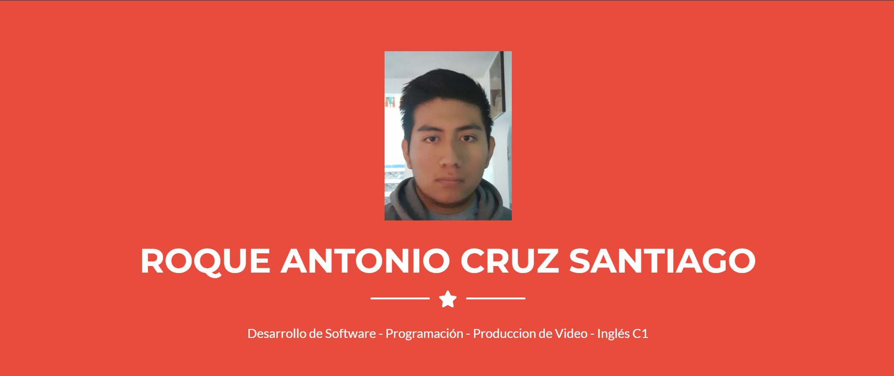
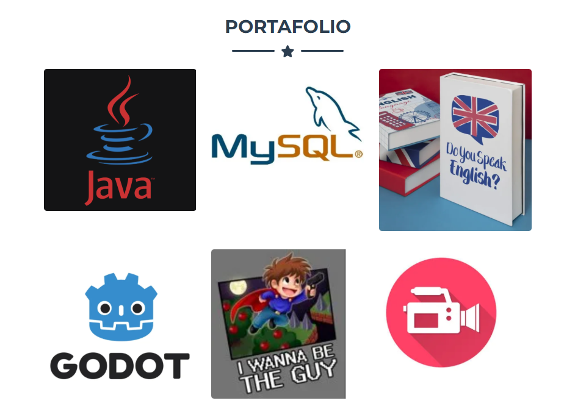
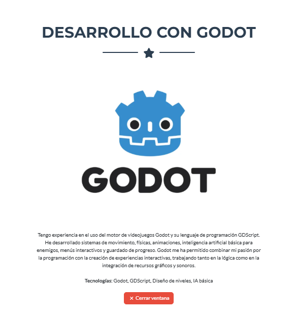
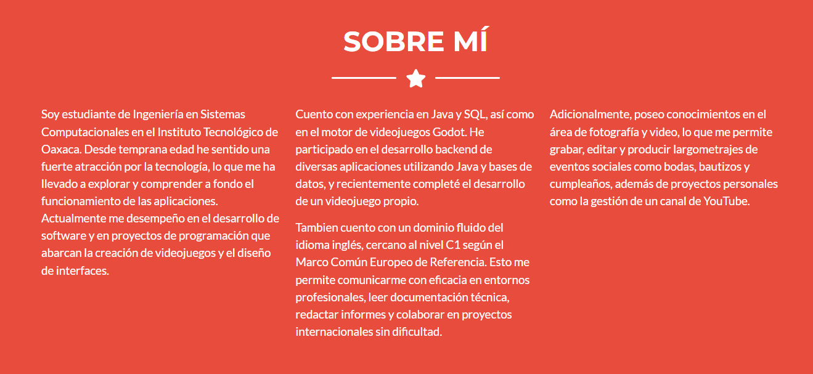
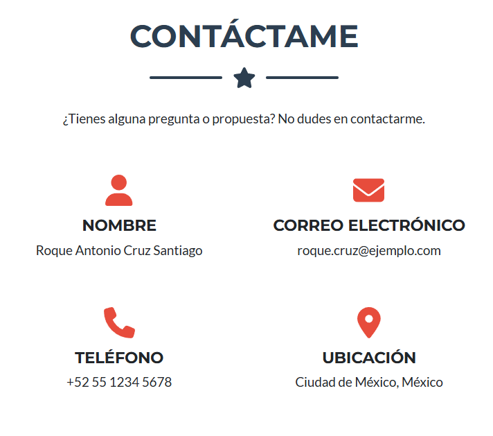

# Portafolio Web - Roque Antonio Cruz Santiago

**Nombre del proyecto:** Portafolio Web Personal  
**Autor:** Roque Antonio Cruz Santiago  
**Institución:** Instituto Tecnológico de Oaxaca  
**Carrera:** Ingeniería en Sistemas Computacionales  
**Materia:** Desarrollo de Aplicaciones Web  
**Actividad:** Actividad 4 - Portafolio Web con Bootstrap o Tailwind

---

## Descripción del proyecto

Este proyecto consiste en un portafolio web personal construido con **HTML, CSS y JavaScript**, utilizando **Bootstrap** como framework CSS base. El portafolio está basado en la plantilla **Freelancer** de Start Bootstrap, la cual fue adaptada y personalizada para reflejar mi perfil profesional, mis habilidades y mis proyectos.

### Framework y plantilla utilizada

- **Framework CSS:** Bootstrap 5.2.3
- **Plantilla:** Freelancer - Start Bootstrap
- **Link de descarga de la plantilla:** [https://github.com/StartBootstrap/startbootstrap-freelancer](https://github.com/StartBootstrap/startbootstrap-freelancer)

### Secciones del portafolio

| Sección | Descripción |
|---------|-------------|
| **Inicio (Masthead)** | Presentación principal con foto de perfil, nombre completo y área de especialización (Desarrollo de Software y Programación). |
| **Portafolio** | Galería de 6 tarjetas que representan mis áreas de conocimiento y proyectos. Cada una abre una ventana modal con descripción detallada. |
| **Sobre mí** | Descripción personal y profesional: estudios, experiencia en desarrollo backend, bases de datos, videojuegos, producción audiovisual y dominio del inglés. |
| **Contacto** | Información de contacto directa: nombre, correo electrónico, teléfono y ubicación. |
| **Footer** | Ubicación, redes sociales y créditos de la plantilla. |

### Detalle de la sección Portafolio

| # | Tema | Título | Descripción breve |
|---|------|--------|-------------------|
| 1 | Java | Desarrollo Backend con Java | Experiencia en desarrollo backend con Java, Spring Boot, JDBC y APIs REST. |
| 2 | MySQL | Bases de Datos con MySQL | Diseño, implementación y administración de bases de datos relacionales. |
| 3 | Inglés | Dominio del Idioma Inglés | Nivel C1 según el MCER, comunicación técnica y redacción profesional. |
| 4 | Godot | Desarrollo con Godot | Experiencia en el motor de videojuegos Godot y GDScript. |
| 5 | Videojuego | I Wanna Get Out | Fangame de *I Wanna Be The Guy* desarrollado en Godot. |
| 6 | Video | Producción Audiovisual | Grabación, edición y producción de video para eventos sociales. |

---

## Proceso de creación

### Paso 1: Descarga de la plantilla

Descargué la plantilla **Freelancer** desde el repositorio oficial de Start Bootstrap en GitHub:
[https://github.com/StartBootstrap/startbootstrap-freelancer](https://github.com/StartBootstrap/startbootstrap-freelancer)

### Paso 2: Adaptación de la estructura

La plantilla original trae una carpeta `dist` con los archivos compilados. Extraje los archivos necesarios y los adapté a mi propia estructura de carpetas:

## Capturas de pantalla

A continuación se muestran capturas del portafolio funcionando en el navegador, demostrando que todas las secciones están operativas y correctamente integradas.

### 1. Vista de inicio (Masthead)
Captura de la sección principal con la foto de perfil, el nombre completo y el área de especialización.

### 2. Sección Portafolio
Captura de la cuadrícula con las 6 tarjetas temáticas del portafolio.

### 3. Modal de proyecto
Captura de una ventana modal abierta, mostrando la descripción detallada de uno de los proyectos.

### 4. Sección Sobre mí
Captura del texto profesional con la descripción personal, estudios y habilidades.

### 5. Sección Contacto
Captura de las tarjetas de información de contacto (nombre, correo, teléfono y ubicación).

